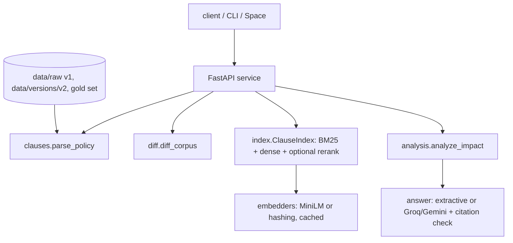
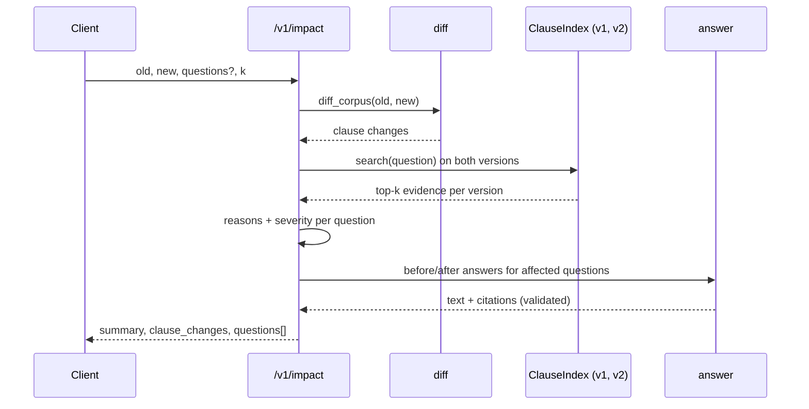

# Policy change impact analysis: design

## Problem
When a compliance policy is revised, teams need to know which previously correct answers (FAQ entries, chatbot replies, audit responses) are now wrong. Re-reading the whole diff does not scale and generic RAG evaluation says nothing about change. PoliRAG's impact analysis diffs two versions at clause level, replays the questions against both versions, and reports the answers likely affected with the clause IDs that explain why.

## Requirements
Functional
- Parse numbered policy text into clauses with stable IDs (`<Document ID>#<clause number>`).
- Clause diff across versions: modified, added, removed, renumbered, unchanged; changed words shown.
- Hybrid retrieval (BM25 + dense, optional cross-encoder rerank) per version; evidence = top-k clauses.
- Report questions whose evidence changed, severity (high: rank-1 evidence changed; medium: other top-k; low: reordered only), before/after answers with citations.
- Answers cite clause IDs. Extractive fallback always available; optional Groq/Gemini generation, validated.
- HTTP service, CLI, Docker, Gradio demo.

Non-functional
- Free to run: CPU only, MiniLM-class models, no paid API required.
- Deterministic given the embedder; hashing embedder gives a no-download mode for tests and offline use.
- Request bodies capped (1 MB, 200 questions); all inputs treated as untrusted text.
- Structured JSON logs with a request ID; `/healthz` (liveness) and `/readyz` (corpora present).

## Architecture

## Data model
- `Clause{doc_id, number, title, body}`; `id = doc_id#number`; `content_hash` over title+body (renumbering keeps the hash).
- `ClauseChange{kind, old, new, similarity, word_changes}`.
- Question row: `id, question, severity, likely_affected, evidence_old[], evidence_new[], reasons[], answer_changed, answer_old, answer_new`.
- Gold set (`data/eval/retrieval_gold.json`): questions with `{doc, quote}` evidence, independent of chunking.

## API contract
| method, path | body | returns |
|---|---|---|
| GET /healthz | | `{status, version}` |
| GET /readyz | | 200 when bundled corpora exist, else 503 |
| GET /v1/versions | | bundled corpora summary |
| POST /v1/diff | `{old, new}` (each `{version}` or `{files}`) | counts + clause changes |
| POST /v1/impact | `{old, new, questions?, k, min_severity, refine}` | summary, clause_changes, questions |
| POST /v1/ask | `{question, corpus, k}` | answer (text, citations, mode) + evidence |
`X-API-Key` is required on `/v1/*` when `API_KEY` is set. Errors: 401, 404 unknown version, 413 too large, 422 validation, 503 not ready.

## Impact rule
For each question: evidence_old and evidence_new are the top-k clauses in each version. Reasons: an old evidence clause was modified or removed; a new evidence clause is modified or added; otherwise the top-k set changed (low). `likely_affected` = severity at least `min_severity` and (with `refine`) the extractive answer text differs between versions, which filters wording-only edits.

## Scaling path
Indexes are in memory and rebuilt per request, with embeddings memoised by text, so repeated analyses of mostly unchanged corpora re-embed only changed clauses. For larger corpora: persist per-version FAISS indexes keyed by clause hash, reuse unchanged vectors, and move analysis to a job queue.

## Failure modes
| failure | mitigation |
|---|---|
| Retrieval returns an unrelated changed clause for an out-of-scope question | Flagged as affected (known). Mitigation planned: abstention threshold on retrieval score |
| Clause renumbering or reorganisation | Matching by number+title, then content hash, then text similarity >= 0.6 |
| Non-numbered documents | One clause only if no numbering; documented limitation |
| LLM unavailable, rate-limited, or cites unknown IDs | Falls back to extractive answer, `mode=extractive-fallback` |
| Model download fails (Space/offline) | Demo falls back to hashing embedder; service fails fast at first request |
| Large or malicious payload | 1 MB / 200-question caps, pydantic validation |

## Security and privacy
Policy text stays in process memory; nothing is persisted or sent anywhere unless a Groq/Gemini key is configured, in which case only the question and retrieved clause text are sent. Optional API key on `/v1/*`; no secrets in the repo (`.env.example`); container runs as non-root; CodeQL and Dependabot enabled. No rate limiting in this service: put it behind a gateway for public exposure.

## Decisions
- ADR-1 Clause is the unit of retrieval and diff: matches how policies are cited and makes IDs stable across versions.
- ADR-2 Extractive answers by default: no generation means nothing unsupported by a cited clause, and the demo needs no keys. LLM output is accepted only if every cited ID was provided.
- ADR-3 Separate light service (`src/impact`) from the legacy OpenAI pipeline: no required API keys, small dependency set, CPU-friendly.
- ADR-4 Oracle evaluation from gold quotes: ground truth for "affected" needs no extra labelling, but only covers gold-evidence changes.

## Cost (free tier)
| component | service | cost |
|---|---|---|
| CI, CodeQL | GitHub Actions | free (public repo) |
| Demo | Hugging Face Space, CPU basic | free |
| Generation (optional) | Groq or Gemini free tier | free, rate limited |
| Models | MiniLM embedder + cross-encoder (~90 MB each) | free |
